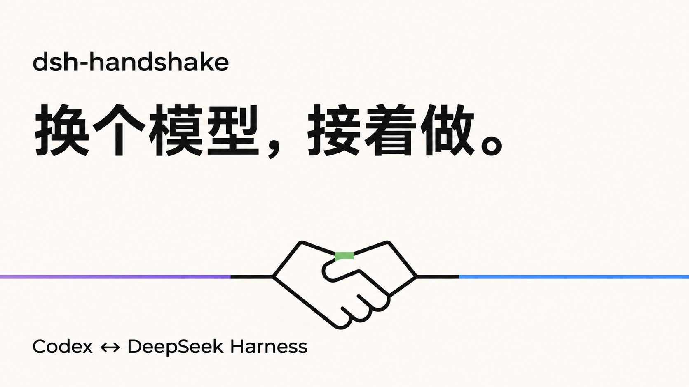

# dsh-handshake

**在 Codex 和 DeepSeek Harness 之间，把同一个开发任务接着做。**



写到一半想换个模型，最麻烦的常常不是复制最后一句话，而是重新说明：这个项目为什么这样做、哪些地方不能动、上次做到哪里，以及眼前的代码有没有又变过。

Handshake 是一个装在 **DeepSeek Harness（DSH）** 里的任务接力插件。选择来源项目，创建交接资料，再确认交给另一端执行。当前只支持 **Codex ↔ DeepSeek Harness**；不是通用的多模型聊天迁移工具。

[下载 v0.1.0](https://github.com/zhangyong0010/dsh-handshake/releases/tag/v0.1.0) · [最新安装包](https://github.com/zhangyong0010/dsh-handshake/releases/latest/download/dsh-handshake.tgz) · [English](#english)

## 为什么不直接发一句 Prompt？

简短任务，手动复制一段 Prompt 就够了。持续几天、改过多轮要求的项目，交接还需要能回查的资料和当前代码状态：

| 换端时需要带走什么 | Handshake 怎么处理 |
| --- | --- |
| 用户中途补充、修改过的要求 | 保存完整用户正文和来源，提示词过长时明确标记为预览，保留可读取的完整文件。 |
| 两个模型共同遵守的目标和约束 | 详情里维护“项目共识”：目标、确认约束、决策、验收标准和补充背景。自动提取的线索单独标记，不冒充确认规则。 |
| 当前代码和未提交改动 | 准备交接时记录分支、HEAD、diff 和文件摘要，启动前再检查。变化后重新准备并再次确认。 |
| 多次往返的关系 | 同一项目复用接力卡，每次准备保留独立资料版本，关联实际来源和目标会话。 |
| 到底交给谁、有没有执行 | 看板区分来源、方向、执行状态和资料核对状态；结束后进入待验收。 |

你也可以用自己的文档和脚本做好这些事。这个插件把它们放进同一个操作流程，减少反复整理，以及只转述最后一段助手总结时遗漏原始要求的机会。它不会让不同模型自动拥有相同能力，也不保证接收模型在语义上理解一致。

## 用起来是什么样

1. 在接力看板找到项目，点击 **创建接力任务**。这一步只整理资料，不启动模型。
2. 查看目标端和交接资料，需要时编辑“项目共识”，然后 **确认执行**。
3. 本轮结束后检查实际改动和测试。需要换回来时，在同一张卡继续接力。

顶部绿色区域放已创建的接力任务；下方左侧紫色为 Codex 来源，右侧蓝色为 DSH 来源。每个来源列内，同一项目的多个主会话聚合成一张候选卡，操作指向最近活动的主会话；项目创建后从两侧待建区排除。

项目按真实目录和持久身份识别，符号链接会归一；同名的无关目录不会合并。搬迁目录需要显式绑定，避免把两个碰巧同名的项目交错。

## 安装与环境

v0.1.0 的本机桌面验证环境为 **macOS、DSH 0.2.2-rc.1、Codex 桌面 App**。需要能读取两个客户端的本地会话记录，并访问同一个本地项目目录。Windows、Linux 和远程/跨机器接力尚未验证。

在 DSH 的插件页选择添加 GitHub 插件，填写：

```text
github:zhangyong0010/dsh-handshake
```

也可以使用 [GitHub Release 提供的预打包文件](https://github.com/zhangyong0010/dsh-handshake/releases/latest/download/dsh-handshake.tgz)。包内是可直接加载的 JavaScript，没有安装期脚本或构建步骤。安装后启用 **DSH-Handshake 任务接力**；如界面仍有缓存，完整退出并重启 DSH。

Codex 优先使用桌面 App 的内置执行程序。其他安装位置可通过插件配置的 `codexBinary` 指定。目标端仍需要自己可用的账号、模型和工具；插件不转移登录信息、额度或权限，也不支持 ChatGPT 普通聊天、Claude、Cursor 等其他客户端。

## 交接与数据边界

- 整理资料不调用来源模型。来源模型已经无法继续时，仍可读取本地记录准备交接。
- 原始会话不改写。交接副本、项目共识、运行日志和逐轮资料保存在本机 `~/.dsh-handshake/`。
- 历史助手结论、工具输出和参考文档不作为新增用户授权；后续明确用户修订优先，历史“此轮不修改”保留其阶段范围。
- 常见凭据形式会在交接副本中脱敏。自动脱敏有边界，确认执行前仍应检查要交给目标模型的资料。
- 资料核对回执绑定文件摘要、资料版本和代码基线。它不证明模型已经正确理解，也不代表任务通过验收；宿主不能强制模型先读后写。
- 同项目执行锁只协调本插件，不能阻止用户在其他应用手动启动工作。若宿主在启动瞬间异常退出，需要结合目标端日志核对，不要把不明状态当成成功。
- 插件没有独立的分析遥测或资料上传服务。确认执行后，目标客户端会按它自己的模型配置处理交接资料。
- v0.1.0 不包含额度查询或额度计量功能。

内部适配依赖 DSH 控制器和 Codex 本地会话格式，上游更新可能需要调整。详情见 [交接格式](docs/handoff.md)。

## 开发与验证

使用 Node.js 24 或更新版本，无需安装项目依赖：

```sh
npm test
```

38 项隔离回归覆盖双向创建与执行接口、多轮往返、重复点击、失败重试、代码漂移、项目身份、原始要求、脱敏、资料回执以及 HTTP/原生路由。测试使用临时 HOME 和模拟接收端，不读取真实用户会话、不启动真实模型。真实 DSH 面板已验证；真实模型完整开发任务尚未作为发布测试执行。

源码前期由 DeepSeek Harness 辅助开发，后续经 Codex 整理、检查和维护。欢迎在 Issue 中反馈可复现的问题；请先去掉会话、日志中的私人信息和凭据。

## English

Handshake is a DeepSeek Harness plugin for handing a development task back and forth between **Codex and DeepSeek Harness only**. Prepare a handoff from a project card, review it, then confirm execution on the receiving client.

A short task may need only a copied prompt. A longer project also needs the original user requirements, shared constraints, current workspace state and a record of earlier handoffs. Handshake preserves attributed user evidence, editable project agreements, versioned handoff documents and workspace checks. It keeps one handoff card per project, with separate purple Codex and blue DSH source sections.

Preparation does not call the source model. A changed source, project agreement or workspace requires a fresh confirmation. Receiving-document receipts verify file hashes and the baseline; they do not prove model understanding or task acceptance. A finished run awaits review.

The tested v0.1.0 desktop environment is macOS with DSH 0.2.2-rc.1 and the Codex desktop app. Other operating systems and cross-machine handoffs are unverified. Each client retains its own account, tools, model capabilities and permissions. The plugin does not migrate other chat applications, transfer quotas or provide quota metering.

Install from `github:zhangyong0010/dsh-handshake` in DSH, or use the [latest prebuilt tarball](https://github.com/zhangyong0010/dsh-handshake/releases/latest/download/dsh-handshake.tgz). Node.js 24+ is used for the dependency-free regression suite (`npm test`). The suite uses isolated fixtures and simulated receivers; it is not a real-model development benchmark.

MIT licensed. See [LICENSE](LICENSE).
